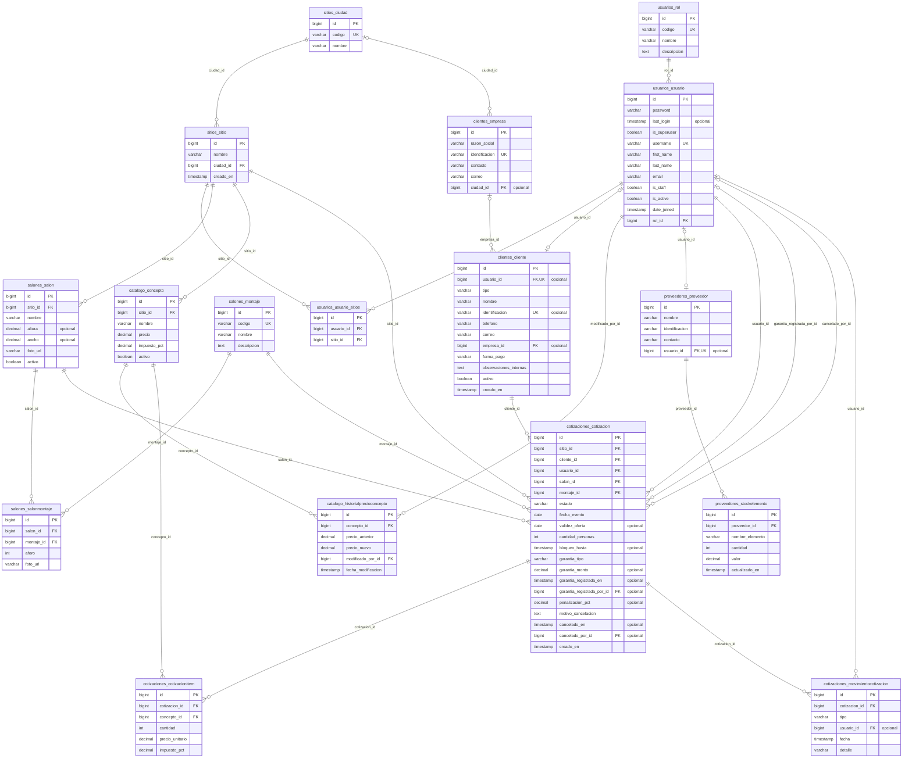

# Modelo relacional de SGDE

Generado desde los `models.py` de `backend/apps/` (16 tablas). Si no coincide con el código, el código manda.
La imagen equivalente está en `Modelo_Relacional_SGDE.png` (fuente: `Modelo_Relacional_SGDE.pu`).

Convenciones: `PK` llave primaria, `FK` llave foránea, `UK` valor único. Las tablas de Django que no son del
negocio (sesiones, permisos, lista negra de tokens) no se muestran.

## Restricciones que no se ven en el diagrama

- `clientes_cliente`: `cliente_juridico_sin_identificacion` (CheckConstraint: condición) — un cliente jurídico no tiene identificación propia (usa el NIT de su empresa)
- `salones_salon`: `uq_sitio_salon_nombre` (UniqueConstraint: sitio, nombre)
- `salones_salonmontaje`: `uq_salon_montaje` (UniqueConstraint: salon, montaje)
- `catalogo_concepto`: `uq_sitio_concepto_nombre` (UniqueConstraint: sitio, nombre)
- `proveedores_stockelemento`: `uq_proveedor_elemento` (UniqueConstraint: proveedor, nombre_elemento)
- `cotizaciones_cotizacion`: `uq_salon_fecha_confirmado` (UniqueConstraint: salon, fecha_evento) — solo cuenta las cotizaciones con estado = confirmado (evita la sobreventa)
